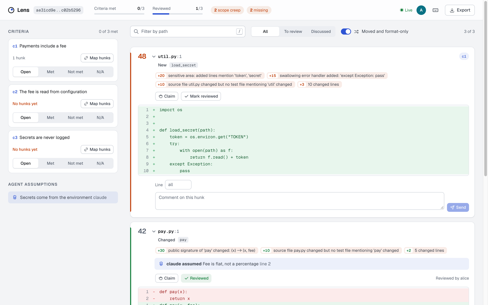

# Lens

Lens (crate and binary: `revlens`) is an open-source CLI and local web app for reviewing a git change against what it was meant to do. It ranks hunks by review risk, reads the intent behind the change (acceptance criteria, agent assumptions), and lets several reviewers work through the change together in real time. At the end it produces a conformance record: which criteria the diff covers, which hunks map to no criterion, and what nobody has reviewed yet.



## The problem

AI coding tools raise the number and size of pull requests, and human review is where they queue up. Faros AI's telemetry study of AI-assisted teams reported PR review time up 91% and PR size up 154%, and the DORA 2025 report associated AI adoption with lower delivery stability. (These are those sources' figures, not Lens measurements.)

AI review bots help, but they read the diff. They do not check the diff against the ticket, the acceptance criteria, or the assumptions the coding agent made along the way. A change can be clean and still miss a requirement, or add something nobody asked for. Lens makes that comparison explicit and keeps a record of it.

Lens complements AI reviewers. Run both.

## Install

Lens is not published to crates.io yet. Install it from GitHub:

```sh
cargo install --git https://github.com/hotocoo/revlens --locked
```

Or from a checkout:

```sh
git clone https://github.com/hotocoo/revlens
cd revlens
cargo install --path . --locked
```

This puts `revlens` in `~/.cargo/bin` (or in `<root>/bin` with `--root <root>`). Tagged releases build binaries for Linux x86_64 musl, macOS arm64 and x86_64, and Windows x86_64, attached to the GitHub release with `.sha256` files. Requires `git` on the PATH; `gh` only for `--pr`.

## Quick start

Rank a change, no setup:

```sh
revlens analyze HEAD~5..HEAD             # any two refs: base..head or base...head
revlens analyze HEAD~5                   # a single ref means ref..HEAD (plain HEAD is an empty range)
revlens analyze HEAD~5..HEAD --json      # full analysis
```

Review it in the browser against an intent file ([example](examples/intent.md)):

```sh
revlens review main..my-branch --intent ticket.md
# Lens review: http://127.0.0.1:PORT/?t=TOKEN
```

Or take the range and criteria from a GitHub PR. Criteria come from list items under an acceptance-criteria heading in the PR body (for example `## Acceptance criteria`); template checklists and HTML comments are ignored:

```sh
revlens review --pr 123
```

Two reviewers: the second one opens the same URL, or the first runs with `--share` and sends the printed URL (see below). Each reviewer picks a name; claims, ticks, criterion mappings and presence show up live in every window. Session state is saved under `.revlens/sessions/` and survives a restart.

Post the conformance record to the PR:

```sh
revlens export --pr 123 --post                     # comment on the PR; reruns edit the same comment
revlens export main..my-branch --intent ticket.md --format json --out record.json
```

### In CI

`--fail-on` exits with status 2 (errors exit 1) when any listed condition holds: `missing-work`, `scope-creep`, `unreviewed`, `reuse-miss`, `not-met`, `open`. `--fail-on-score N` fails when any hunk scores N or more. CI has no review session, so `unreviewed` and `open` hold for every change there; use them only after a review.

The repository is also a GitHub Action. It downloads a release binary, posts the record on the PR and writes it to the job summary:

```yaml
on: pull_request
permissions:
  contents: read
  pull-requests: write
jobs:
  lens:
    runs-on: ubuntu-latest
    steps:
      - uses: actions/checkout@v7
        with:
          fetch-depth: 0          # merge base must be reachable
      - uses: hotocoo/revlens@v0.2.0
        with:
          fail-on: missing-work,reuse-miss
          fail-on-score: 60
```

Inputs: `version` (default `latest`), `pr` (default: the triggering PR), `intent` (file used instead of the PR body), `post` (default `true`), `fail-on`, `fail-on-score`, `args` (extra `export` flags), `token`. Output: `record`, the path of the Markdown record.

Pass the same range and the same `--intent`, `--pr`, or `--assumptions` to `export` as to `review`: the session is keyed on them, and with a different set `export` warns and uses an empty state.

After a force-push or rebase the commits change, so the session does too. Lens keeps a `<session>.meta.json` beside each session with the range as typed (or the PR number), the criteria, and an anchor per hunk: its path and changed lines, without line numbers. A new session with no file yet takes over the newest earlier session with the same range text (or PR) and criteria. Criterion status carries over; reviewed marks, mappings and claims carry over for every hunk whose anchor is found again, and Lens prints how many were. Hunks whose content changed start unreviewed.

### Flags

| Command | Flags |
| --- | --- |
| `analyze <RANGE>` | `--repo <PATH>`, `--json`, `--no-reuse`, `--no-cache` |
| `review [RANGE]` | `--repo`, `--intent <FILE>`, `--pr <N>`, `--assumptions <FILE>`, `--share`, `--port <N>`, `--no-open`, `--no-reuse`, `--no-cache`, `--llm-intent` |
| `mcp` | `--repo`, `--assumptions <FILE>` |
| `export [RANGE]` | `--repo`, `--intent`, `--pr`, `--assumptions`, `--no-reuse`, `--no-cache`, `--llm-intent`, `--format md\|json`, `--out <FILE>`, `--post`, `--fail-on <LIST>`, `--fail-on-score <N>` |

`RANGE` is optional with `--pr`. With both `--pr` and `--intent`, the range comes from the PR and the criteria from the file. `--post` needs `--pr`.

## How ranking works

Each hunk gets points from rules. Every point has a reason shown next to the hunk, so the score can be argued with. Hunks are ordered by score, then path and line, so the order is deterministic.

| Rule | Default points | Fires when |
| --- | --- | --- |
| `public_sig_changed` | 30 | A public function or class changes signature, or is removed |
| `test_removed` | 30 | A test file is deleted, a test is removed, or assertions drop in a test file |
| `new_dependency` | 25 | A dependency is added to `package.json`, `pyproject.toml`, `Pipfile`, `requirements*.txt`, `Cargo.toml` or `go.mod` (`// indirect` requirements excluded) |
| `sensitive_area` | 20 | Path or added lines match `auth`, `token`, `secret`, `sql`, `eval(` and similar |
| `reuse_miss` | 20 | An added function duplicates, or is at least `near_duplicate_percent` (75%) similar to, one that already exists in the base tree |
| `suppression_added` | 15 | `@ts-ignore`, `as any`, `# type: ignore`, `# noqa`, `eslint-disable`, `#[allow(`, `//nolint` and similar are added (a marker that was already on a removed line of the same hunk does not count) |
| `error_handling_weakened` | 15 | `try`/`catch`/`except` is removed, or a swallowing handler is added |
| `infra_config` | 15 | CI, Docker, Terraform, Makefile and similar config changes |
| `no_test_touch` | 10 | A source file changes and no changed test file mentions it |
| `size` | up to 10 | `min(size_cap, log2(changed lines))` |

All weights, patterns and thresholds are configurable, see [Configuration](#configuration).

Similarity for `reuse_miss` is the Jaccard overlap of 4-token runs of the two functions' syntax trees, with names and literals abstracted, so a copy that gained or lost a few statements is still found. An identical shape reads "duplicates"; a near one reads "is 82% similar to".

Definitions are parsed on all cores (`limits.threads`). The analysis is cached in `.revlens/cache/`, keyed by the three commit shas, the effective configuration and the Lens version, so a hit is always current; `--no-cache` recomputes. Add `.revlens/cache/` to your `.gitignore`.

### Moved, renamed and format-only changes

Lens detects moved functions (within a file and between files) and whitespace-only changes, using tree-sitter fingerprints of the definitions plus a line-based fallback. A hunk is only a move when every changed line is accounted for; a hunk that also carries edited lines is scored normally. Moved and whitespace-only hunks score 0 and are labelled, for example "moved from httpx/_utils.py:12" ("moved to" on the side that only removes the code), but they are never hidden. A moved function that was also edited is reported as moved and changed, and its inner diff is shown. A renamed function is not a pure move: it is scored like any change, and renaming a public symbol fires `public_sig_changed`. Generated files and lockfiles also score 0 and stay listed. In indentation-sensitive files (Python, YAML, Makefile) whitespace edits are not treated as formatting.

Languages: TypeScript, TSX, Python, Rust, Go. Rust items are public with a `pub` modifier (trait items and trait-impl methods follow their trait), `#[test]` and `#[cfg(test)]` mark tests, and methods are qualified by their `impl` type. Go names are public when exported (upper case), methods are qualified by receiver type, and `Test`/`Benchmark`/`Fuzz`/`Example` functions are tests.

## Intent

Pass a markdown file with `--intent`, or write the criteria in a PR body and use `--pr`.

- If the document has a heading containing `acceptance`, `criteria`, `requirements`, `definition of done` or `AC` (whole word, case-insensitive, configurable), the list items under it are the criteria. Without such a heading, every top-level list item is.
- List items can be `-`, `*`, `+`, `1.` or `1)`, with or without `[ ]` / `[x]` checkboxes. Indented sub-items are not criteria.
- Given / When / Then lines (plain or as list items) are grouped into one criterion per scenario.
- Fenced code blocks are ignored.

```markdown
## Acceptance criteria

- [ ] More than 5 failed logins per minute from one IP are rejected with HTTP 429
- [ ] The limit is read from configuration

### Scenario: lockout expires

Given an IP that has been rate limited
When the window passes
Then the next login attempt is evaluated normally
```

### Criteria from a model (opt-in)

For tickets written as prose, `--llm-intent` asks a model to extract the criteria. Lens has no API client and stores no keys: it runs the command you configure, writes `intent.llm_prompt` and the document to its stdin, and expects a JSON array of strings on stdout.

```toml
# .revlens/config.toml
[intent]
llm_command = ["claude", "-p"]   # any command that reads stdin, e.g. ["llm", "-m", "some-model"]
```

```sh
revlens review main..my-branch --intent ticket.md --llm-intent
```

The first answer for a given document, command and prompt is cached in `.revlens/cache/` and reused by every later `review` and `export`, so both see the same criteria (sessions are keyed on them). Delete the cache entry to ask again. The reply is checked: at most `llm_max_criteria` criteria of at most `llm_max_chars` characters each, and the command is killed after `llm_timeout_secs`.

In the UI, each criterion has a **Map hunks** button. Click it to enter map mode: a bar at the bottom of the window names the criterion, and every hunk shows a **Map to <id>** toggle. Click the toggles for the hunks that implement the criterion, then **Done** (or click the criterion's button again). Each criterion is also marked Open, Met, Not met or N/A.

## Agent assumptions

Coding agents can record what they assumed by appending one JSON object per line to `.revlens/assumptions.jsonl` (or the file given with `--assumptions`). Lens shows them beside the hunk they point at, or in a general list.

```jsonl
{"text":"Assumed the fee is flat, not a percentage","agent":"claude","path":"app/billing.py","line":3,"at":"2026-10-15T09:12:00Z"}
```

Only `text` is required; `agent`, `path`, `line` and `at` are optional. A missing file means no assumptions; a malformed line is an error that names the line.

Agents that speak the Model Context Protocol can record assumptions through a tool instead. `revlens mcp` serves one tool, `record_assumption` (`text`, optional `agent`, `path`, `line`), on stdio and appends to the same file with `at` set. Input is checked first: `text` is required and capped (`mcp.max_text_chars`), `path` must be an existing repository-relative file without `..`, and `line` needs `path`. For Claude Code, add it to `.mcp.json` in the repository:

```json
{ "mcpServers": { "revlens": { "command": "revlens", "args": ["mcp"] } } }
```

## Conformance record

`revlens export` prints Markdown (default) or JSON (`--format json`, schema version 1) with:

| Field | Meaning |
| --- | --- |
| `range` | Base, head and merge base |
| `generated_at` | UTC timestamp |
| `reviewers` | Everyone who mapped, ticked or claimed in the session |
| `criteria` | Each criterion, its status, and the hunks mapped to it |
| `scope_creep` | Hunks mapped to no criterion (moved, format-only and generated hunks excluded) |
| `missing_work` | Criteria with no hunks, unless marked N/A |
| `unreviewed` | Hunks nobody marked reviewed |
| `reuse_misses` | Hunks that duplicate existing code |

## Live sessions and security

`revlens review` starts an HTTP and WebSocket server. The shared state is a CRDT document ([yrs](https://github.com/y-crdt/y-crdt) on the server, Yjs in the browser over the y-websocket protocol).

- Binds to `127.0.0.1` by default, on a free port unless `--port` or `server.port` is set.
- A random 128-bit token is generated per run and printed in the URL. Every API and WebSocket request needs it (`?t=` or `Authorization: Bearer`). Comparison is constant-time. Nothing is embedded in the binary.
- `--share` binds to `server.share_bind` (default `0.0.0.0`) so teammates on the network can join; send them the full URL. Traffic is plain HTTP: use it on a trusted network or behind a tunnel you control.
- Requests that carry an `Origin` header must match `Host`, which blocks other web pages and DNS rebinding.
- Limits, all configurable: WebSocket message size (1 MiB), session document size (8 MiB), concurrent connections (64).
- Sessions persist to `.revlens/sessions/` (git-ignored by this repo, add it to yours).

## Configuration

Put overrides in `.revlens/config.toml` at the repository root. Every key is optional and unknown keys are an error. [`examples/config.toml`](examples/config.toml) lists every default, and a test keeps it identical to the built-in values.

```toml
[weights]
test_removed = 50

[patterns]
sensitive = ["auth", "billing"]

[server]
port = 4100
```

Setting a list replaces the default list.

## Comparison

Based on each project's public description; check them for current details.

| | Lens | CodeRabbit | Devin Review | Diffcore | difftastic | Graphite |
| --- | --- | --- | --- | --- | --- | --- |
| Open source | Yes (MIT or Apache-2.0) | No | No | No license file in its repository | Yes | No |
| Runs locally | Yes | Hosted service | Hosted service | Yes | Yes | Hosted service |
| AI-written review comments | No | Yes | Yes | No | No | Yes |
| Structural (AST) diff | Yes | n/a | n/a | Yes | Yes | n/a |
| Risk-ranked hunks with reasons | Yes | No | No | Yes | No | No |
| Checks diff against stated intent | Yes | No | No | No | No | No |
| Records agent assumptions | Yes | No | No | No | No | No |
| Live multi-reviewer session | Yes | No | No | No | No | PR review UI |
| Conformance record | Yes | No | No | No | No | No |

Lens does not replace an AI reviewer: it gives the humans (and the AI's output) a ranked, intent-aware way to read the change. difftastic is a diff viewer and a good one; Lens uses similar parsing but is about review workflow, not display.

## Roadmap

Not in 0.1.0:

3. Comment threads and cursors

## Contributing

See [CONTRIBUTING.md](CONTRIBUTING.md).

## License

Licensed under either of [Apache License, Version 2.0](LICENSE-APACHE) or [MIT license](LICENSE-MIT) at your option.
